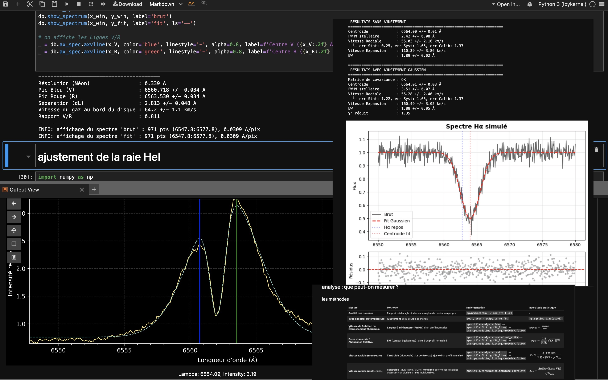

# SAR colab : l'espace sciences colaboratif de la [Société d'Astronomie de Rennes](https://astrorennes.fr)

## Expérimentation à distance :
- lancer : 
- attendre le lancement de l'onglet jupyter (bouton `show` pour visualiser l'avancement)

## Installation en local :
- installer miniforge3 : `https://github.com/conda-forge/miniforge`
- récupérer le code :  `git clone https://github.com/plouis35/SAR_colab.git`
- installer les packages requis :  `$ cd SAR_colab;  $ conda env update --file environment.yml`
- lancer le serveur jupyter lab : `$ jupyter lab`
- attendre l'ouverture d'un onglet jupyter sur votre navigateur par défaut

## Utilisation :

- double-cliquer sur le répertoire 'notebooks'
- double-cliquer sur un notebook pour l'ouvrir
- executer les cellules un par une (touche SHIFT-ENTER) ou le notebook complet (menu RESTART KERNEL AND RUN ALL CELLS)
